# AWS Architecture Diagram — eScience Website

## High-Level Architecture

```mermaid
graph TB
    subgraph Client["Client Layer"]
        Browser["🌐 Browser"]
    end

    subgraph Edge["Edge / CDN"]
        CF["☁️ Amazon CloudFront<br/>CDN Distribution"]
        ACM["🔒 AWS ACM<br/>SSL Certificate<br/>(us-east-1)"]
    end

    subgraph Storage["Storage Layer"]
        S3Static["📦 S3: esc-website-static<br/>Static HTML/CSS/JS/Assets"]
        S3Uploads["📦 S3: esc-uploads<br/>User Media (Private)<br/>Pre-signed URLs"]
    end

    subgraph API["API Layer"]
        APIGW["🔀 API Gateway<br/>(REST or HTTP API)<br/>Path: /api/*"]
    end

    subgraph Auth["Authentication"]
        Cognito["🔐 Amazon Cognito<br/>User Pool + App Client<br/>Admin Auth / JWT"]
    end

    subgraph Compute["Compute Layer — Lambda Functions"]
        LContent["λ content<br/>GET/POST /api/content"]
        LSub["λ subscribers<br/>POST /subscribe<br/>GET/DELETE /subscribers"]
        LUpload["λ upload<br/>POST /api/upload<br/>(pre-signed URL)"]
        LUploadsList["λ uploads-list<br/>GET /uploads<br/>DELETE /upload/:file"]
        LTrack["λ analytics-track<br/>POST /analytics/track"]
        LAnalytics["λ analytics<br/>GET /analytics"]
        LArchive["λ analytics-archive<br/>POST/GET/DELETE"]
        LIcons["λ icons<br/>GET /api/icons"]
        LSavePage["λ save-page<br/>POST /api/save-page"]
        LBackup["λ backup-restore<br/>GET/POST"]
        LEmail["λ email<br/>SES Utility"]
    end

    subgraph Database["Database Layer — DynamoDB"]
        DBContent["📋 esc-content<br/>PK: sectionKey"]
        DBSubs["📋 esc-subscribers<br/>PK: email"]
        DBAnalytics["📋 esc-analytics<br/>PK: date, SK: type"]
        DBArchives["📋 esc-analytics-archives<br/>PK: archiveId"]
        DBTokens["📋 esc-reset-tokens<br/>PK: token (TTL)"]
    end

    subgraph Email["Email Service"]
        SES["✉️ Amazon SES<br/>sales@electronicscience.net"]
    end

    subgraph Scheduling["Scheduling"]
        EB["⏰ EventBridge Scheduler<br/>cron(0 0 1 * ? *)<br/>Monthly Archive"]
    end

    subgraph CICD["CI/CD"]
        GHA["⚙️ GitHub Actions"]
        SAM["📐 AWS SAM / Terraform<br/>Infrastructure as Code"]
    end

    %% Client → Edge
    Browser -->|HTTPS| CF
    ACM -.->|TLS cert| CF

    %% Edge → Origins
    CF -->|Default origin| S3Static
    CF -->|/api/* origin| APIGW
    CF -->|OAC| S3Uploads

    %% API Gateway → Auth + Lambdas
    APIGW -->|Cognito Authorizer| Cognito
    APIGW --> LContent
    APIGW --> LSub
    APIGW --> LUpload
    APIGW --> LUploadsList
    APIGW --> LTrack
    APIGW --> LAnalytics
    APIGW --> LArchive
    APIGW --> LIcons
    APIGW --> LSavePage
    APIGW --> LBackup

    %% Lambda → DynamoDB
    LContent --> DBContent
    LSub --> DBSubs
    LTrack --> DBAnalytics
    LAnalytics --> DBAnalytics
    LArchive --> DBAnalytics
    LArchive --> DBArchives
    LBackup --> DBContent
    LBackup --> DBSubs
    LBackup --> DBAnalytics
    LBackup --> DBArchives

    %% Lambda → S3
    LUpload -->|Pre-signed PUT URL| S3Uploads
    LUploadsList --> S3Uploads
    LIcons --> S3Static
    LSavePage --> S3Static

    %% Lambda → SES
    LSub --> LEmail
    LEmail --> SES

    %% EventBridge → Lambda
    EB -->|Monthly trigger| LArchive

    %% CI/CD
    GHA -->|sync public/| S3Static
    GHA -->|sam deploy| SAM
    SAM -->|provisions| APIGW
    SAM -->|provisions| Compute

    %% Browser direct upload
    Browser -.->|PUT via pre-signed URL| S3Uploads

    %% Cognito direct calls from browser
    Browser -.->|SDK: signIn, signOut,<br/>forgotPassword, etc.| Cognito
```



## AWS Services Summary

| Service | Purpose | Count/Details |
|---|---|---|
| **Amazon S3** | Static hosting + media storage | 2 buckets |
| **Amazon CloudFront** | CDN, HTTPS termination, routing | 1 distribution, 2 origins |
| **AWS ACM** | SSL/TLS certificate | 1 cert (us-east-1) |
| **Amazon API Gateway** | REST API routing + CORS | ~15 routes |
| **AWS Lambda** | Serverless compute | 11 functions |
| **Amazon DynamoDB** | NoSQL database | 5 tables |
| **Amazon Cognito** | Admin authentication (JWT) | 1 User Pool, 1 App Client |
| **Amazon SES** | Transactional email | 1 verified domain |
| **Amazon EventBridge** | Scheduled monthly archive | 1 cron rule |
| **AWS SAM / Terraform** | Infrastructure as Code | Full stack definition |
| **GitHub Actions** | CI/CD pipeline | 2 jobs (frontend + backend) |

## Data Flow Patterns

### Public (No Auth)
```
Browser → CloudFront → API GW → Lambda → DynamoDB/S3
```
- `GET /api/content` — fetch site content
- `POST /api/subscribe` — newsletter signup → SES email
- `POST /api/analytics/track` — page view tracking
- `GET /api/icons` — list icon assets

### Authenticated (Cognito JWT)
```
Browser → Cognito SDK (get IdToken)
Browser → CloudFront → API GW → Cognito Authorizer ✓ → Lambda → DynamoDB/S3
```
- All admin CRUD operations (content, uploads, analytics, backup/restore)

### Direct Upload (Pre-signed URL)
```
Browser → Lambda (get pre-signed URL) → Browser PUT → S3 esc-uploads
```

### Scheduled
```
EventBridge (1st of month) → Lambda → DynamoDB (archive + reset)
```
